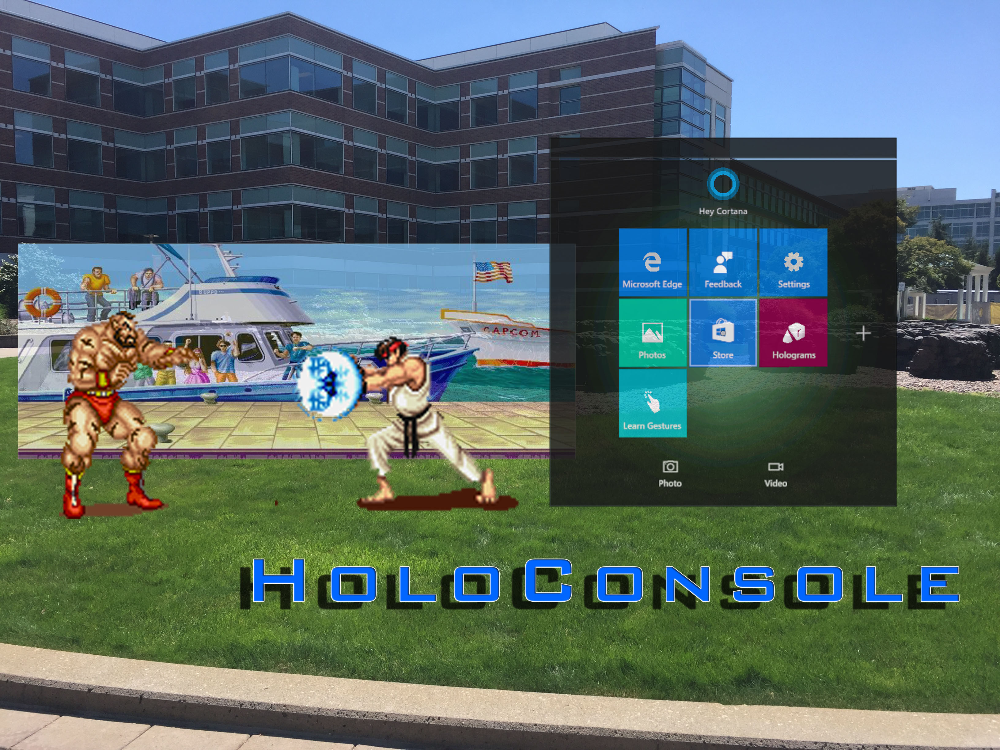

# EmuXR

**EmuXR** is an Android XR experiment that brings classic game rendering into
spatial space. The goal is simple: keep the original game image honest, then
use rendering-layer information to explore a little depth for fun.

> This is an independent, unofficial project. It is not affiliated with or
> endorsed by Microsoft, the mGBA project, console manufacturers, or game
> rights holders. No ROMs, BIOS files, or copyrighted game assets are included.



*Historical HoloLens reference image from the original internal prototype.*

## The story

The project started in 2016 inside Microsoft for HoloLens. It was targeting to
provide more game options, leveraging the good retro gaming community. To show
the uniqueness, we tried to add depth data (Z-axis) from the classic game
rendering pipeline for fun. The project was built inside Unity but not publicly
released.

Fast forward: spatial hardware is now much more powerful than the original
HoloLens. I decided to revive the effort with the latest tech stack. No
proprietary code was used in this practice.

Today, EmuXR is a clean-room Android XR proof of concept tested on Samsung
Galaxy XR with an Xbox controller. It starts with GBA and Direct mGBA, while
keeping an engine-independent path for future cores and platforms.

## What it does

The baseline is still the original resolved GBA screen. When a compatible
rendering path can describe its candidates, EmuXR can separate selected visual
sources—such as background and object layers—into spatial planes. The user can
stay with the original view or try the 2.5D presentation experiments.

```text
Instrumented emulator core
        ↓ resolved pixels + optional pixel provenance
Engine-independent C ABI bridge
        ↓ frame leases and layer candidates
Unity 6 URP + OpenXR on Android XR
        ↓
Original screen or experimental 2.5D spatial presentation
```

The current implementation includes:

- Direct mGBA rendering through a native Android ARM64 bridge.
- Pixel/provenance fixtures for GBA priority, blending, windows, affine
  backgrounds, and object behavior.
- Unity 6 URP/OpenXR rendering for Samsung Galaxy XR.
- Original, Auto, ForcePartition, and parallax presentation experiments.
- ROM selection through Android's picker, controller mapping, save/load slots,
  audio, and optional spatial screen placement.
- A narrow libretro-compatible host boundary as an example for broader core
  compatibility.

## Caveats

- The 2.5D experience would cost up to 4× streaming bandwidth compared with a
  single consolidated screen. So it can consume more power.
- Libretro API is added as an example for general compatibility only. To expose
  detailed pixel metadata, a separate core-specific pipeline is still needed.
- Performance optimization is still in the work.
- The current physical validation is on Android XR with an Xbox controller.
- Layer separation is an experiment, not a claim that every ROM can be safely
  converted to 2.5D. The Original view remains the compatibility fallback.

## Project layout

- `native/` — stable C ABI, mGBA adapter boundary, compositor, and native
  contract tests.
- `unity/` — Unity 6 Android XR project, UI, rendering, and EditMode tests.
- `fixtures/` — source-only synthetic fixture definitions and test inputs.
- `docs/` — architecture, build, validation, release, and future-core plans.

## Quick start: native checks

```powershell
cmake -S native -B build/native -DBUILD_TESTING=ON
cmake --build build/native --config Debug
ctest --test-dir build/native -C Debug --output-on-failure
```

For Unity/Android XR setup and device validation, start with
[`docs/BUILD.md`](docs/BUILD.md) and
[`docs/DEVICE_VALIDATION.md`](docs/DEVICE_VALIDATION.md).

## Core and license boundary

EmuXR frontend and bridge code are Apache-2.0. The instrumented mGBA source is
maintained separately in
[`buptrain/mgba-parallax`](https://github.com/buptrain/mgba-parallax) under
MPL-2.0. A distributed core binary must identify its exact matching source tag,
commit, notices, and checksum. See
[`THIRD_PARTY_NOTICES.md`](THIRD_PARTY_NOTICES.md) and
[`docs/PUBLIC_RELEASE_GATE.md`](docs/PUBLIC_RELEASE_GATE.md).

## Release preparation

The public source mirror and GitHub sideload-release procedure are intentionally
separate from private development. See
[`docs/GITHUB_UNOFFICIAL_RELEASE.md`](docs/GITHUB_UNOFFICIAL_RELEASE.md) before
publishing source or an APK.
